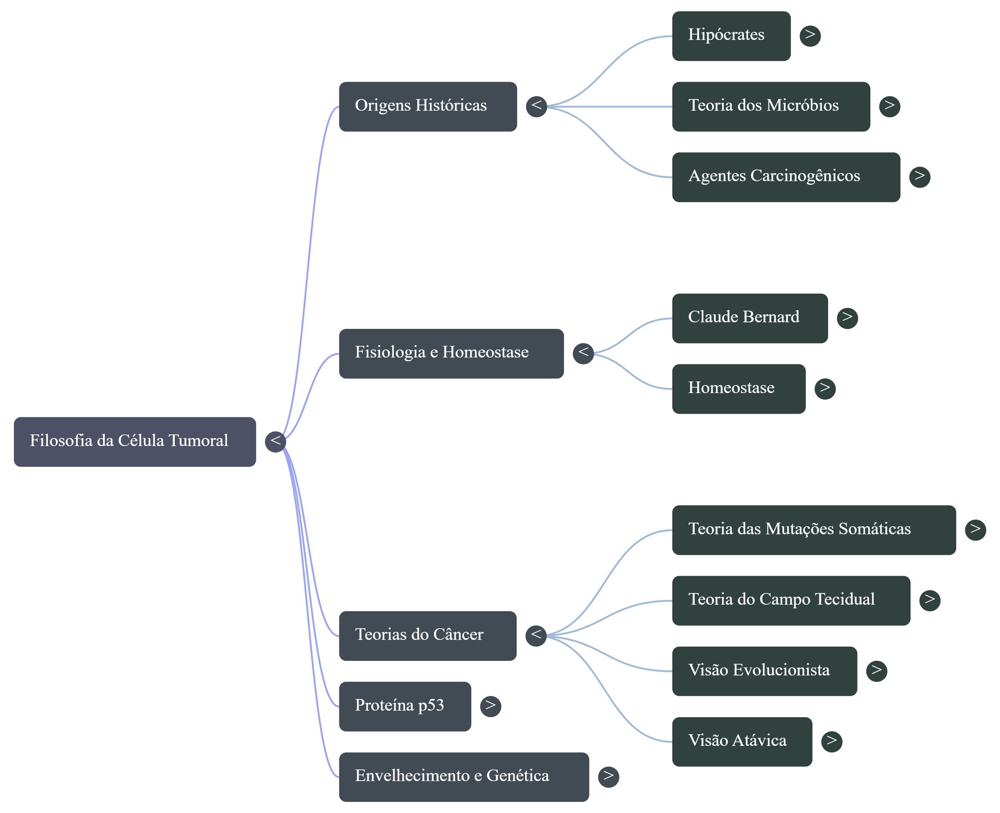
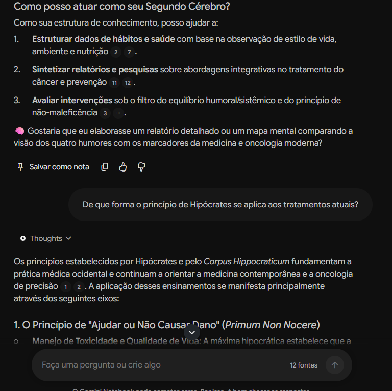
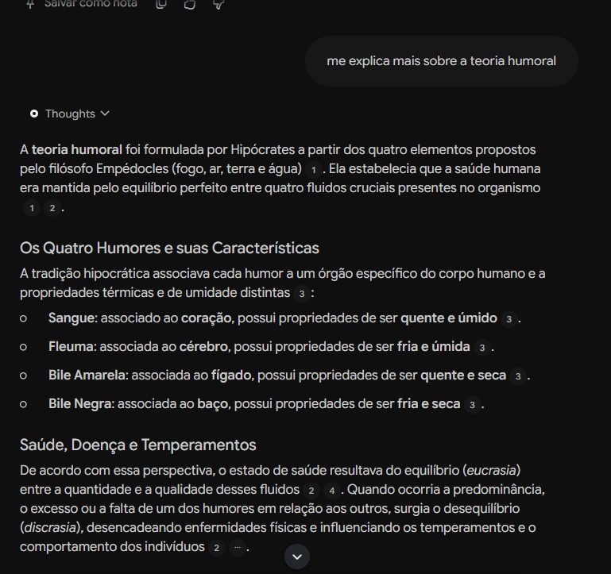
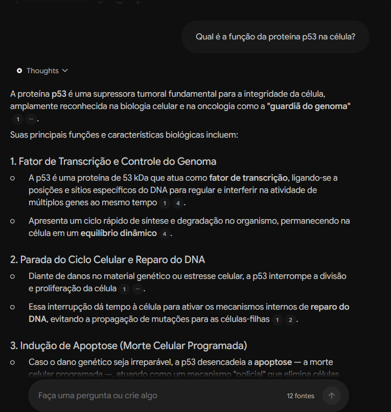
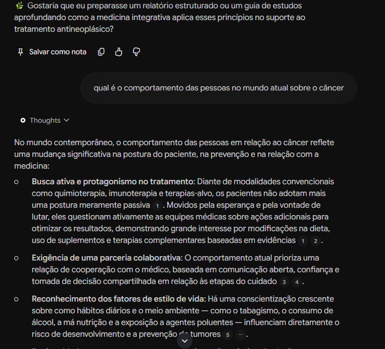

# 🧬 Segundo Cérebro: Filosofia da Célula Tumoral e a Metodologia de Hipócrates

Documentação do Segundo Cérebro construído com o **Google NotebookLM**, sintetizando as bases conceituais, históricas e moleculares das neoplasias: desde as origens da observação clínica em Hipócrates até as teorias modernas da oncologia e biologia celular.

---

## 🎯 Tema e Objetivo

> *"Comporte-se como um segundo cérebro baseado nos ensinamentos do Hipócrates, e sua metodologia de tipos de câncer."*

O objetivo central foi estruturar um ecossistema de conhecimento navegável e fundamentado para investigar a transição do pensamento médico sobre o câncer:
1. **Fase Histórica e Sistêmica:** a observação do paciente como um todo, o equilíbrio dos humores e o princípio ético do *Primum Non Nocere* ("Primeiro, não causar dano").
2. **Fisiologia e Meio Interno:** o conceito de homeostase introduzido por Claude Bernard.
3. **Fronteira Molecular e Teórica:** o papel da proteína p53 como "guardiã do genoma" e o debate entre as teorias do câncer (Mutações Somáticas, Campo Tecidual, Visão Evolucionista e Atávica).

---

## 🗺️ Mapa Mental: Filosofia da Célula Tumoral

Abaixo está o mapa conceitual que sintetiza as ramificações de estudo consolidadas no Segundo Cérebro:

---

## 📚 Curadoria de Fontes e Critérios de Confiabilidade

O caderno foi alimentado com **12 fontes rigorosamente selecionadas** (artigos acadêmicos, capítulos de história da ciência e palestras especializadas):

- **Fidelidade Histórica:** textos ancorados no *Corpus Hippocraticum* e na evolução do pensamento médico clássico.
- **Rigor Fisiológico e Oncológico:** estudos que articulam os conceitos de Claude Bernard, homeostase e as teorias contemporâneas da carcinogênese.
- **Grounding e Validação Cruzada:** fontes que contrapõem a teoria das mutações somáticas à teoria do campo tecidual e visões evolutivas, permitindo respostas críticas e sem alucinações.

---

## ⚙️ Diretrizes de Comportamento (System Prompt)

Para atuar como Segundo Cérebro, o agente foi calibrado para:
1. **Atuar como estrutura de conhecimento:** organizar hábitos, nutrição e fatores ambientais sob uma ótica sistêmica *(Fontes [2], [7])*.
2. **Avaliar intervenções médicas:** analisar tratamentos sob o filtro da não-maleficência e do equilíbrio dinâmico *(Fonte [3])*.
3. **Respostas 100% ancoradas:** só emitir juízos clínicos ou históricos que possuam citação rastreável nas 12 fontes.

---

## 🔍 Evidências do Chat e Grounding com Citações

As evidências abaixo comprovam a aderência estrita do modelo às fontes de referência:

### 1. Princípios Hipocráticos na Oncologia Atual
* **Pergunta:** *"De que forma o princípio de Hipócrates se aplica aos tratamentos atuais?"*
* **Resposta:** O modelo demonstrou como o *Primum Non Nocere* baliza o cálculo de toxicidade na quimioterapia, o manejo de efeitos adversos e a personalização de protocolos na oncologia de precisão *(Citações: fontes [1], [2], [3])*.

---

### 2. A Teoria Humoral e Fisiopatologia Clássica
* **Pergunta:** *"Me explica mais sobre a teoria humoral"*
* **Resposta:** Mapeamento da derivação dos 4 elementos de Empédocles para os fluidos corporais:

| Humor | Órgão Associado | Propriedades | Relevância Oncológica / Histórica |
| :--- | :--- | :--- | :--- |
| **Sangue** | Coração | Quente e Úmido | Força vital e temperamento sanguíneo *(Fonte [3])* |
| **Fleuma** | Cérebro | Fria e Úmida | Lubrificação e temperamento fleumático *(Fonte [3])* |
| **Bile Amarela** | Fígado | Quente e Seca | Digestão e temperamento colérico *(Fonte [3])* |
| **Bile Negra** | Baço | Fria e Seca | Considerada historicamente a origem das neoplasias *(Fonte [3])* |

> **Eucrasia** (harmonia humoral = saúde) versus **Discrasia** (desequilíbrio = doença) *(Fontes [2], [4])*.

---

### 3. Biologia Celular Moderna: A Proteína p53
* **Pergunta:** *"Qual é a função da proteína p53 na célula?"*
* **Resposta:** Síntese da atuação da p53 como a **"guardiã do genoma"**, operando no controle do ciclo celular, no reparo de DNA contra mutações e na indução de apoptose quando o dano genético é irreversível *(Citações: fontes [1], [2], [4])*.

---

### 4. Protagonismo do Paciente no Cenário Contemporâneo
* **Pergunta:** *"Qual é o comportamento das pessoas no mundo atual sobre o câncer"*
* **Resposta:** Identificação de uma mudança de postura: do paciente passivo para a parceria colaborativa médico-paciente e busca ativa por prevenção, nutrição e terapias complementares baseadas em evidências *(Citações: fontes [1], [2], [3], [4], [5])*.

---

## 📂 Artefatos do Projeto

- 🗺️ **Mapa Mental:** [`assets/mapa-mental.png`](assets/mapa-mental.png.png)
- 📑 **Slides de Apresentação:** [`docs/slides-resumo.pdf`](docs/slides-resumo.pdf.pdf)
  

Devido à alta qualidade e duração dos materiais audiovisuais, os arquivos pesados estão hospedados diretamente no [GitHub Releases](https://github.com/SEU_USUARIO/SEU_REPOSITORIO/releases) do projeto.

---

### 🎙️ Imersão em Áudio (30 minutos)
Um podcast explicativo aprofundado sintetizando toda a metodologia de Hipócrates, a teoria humoral, a homeostase e as teorias modernas da célula tumoral:

- 🎧 **[Clique aqui para Baixar / Ouvir o Áudio Completo (M4a)](sha256:8ef9b3b104ed322c6687f732e9107719c4f4556c250b83b236230408897f2768)**

---

### 📑 Apresentação em Video (12 minutos)
Material visual didático com o roteiro completo da pesquisa e síntese teórica:

- 📥 **[Clique aqui para Baixar / Ouvir o vídeo da Apresentação (MP4)](sha256:9f96c8884a5aa8591f85379f84f2fab20f5b7980a0d2602ade4445418d0f4bd5)**

---

### 🗺️ Mapa Mental Conceitual
Visão esquemática das ramificações do conhecimento:
- 🖼️ [Visualizar Mapa Mental em Alta Resolução](assets/mapa-mental.png.png)

## 👩‍💻 Autoria
Desenvolvido por **Marielen S**, como parte do estudo de Segundo Cérebro com Inteligência Artificial e Curadoria de Conhecimento.

